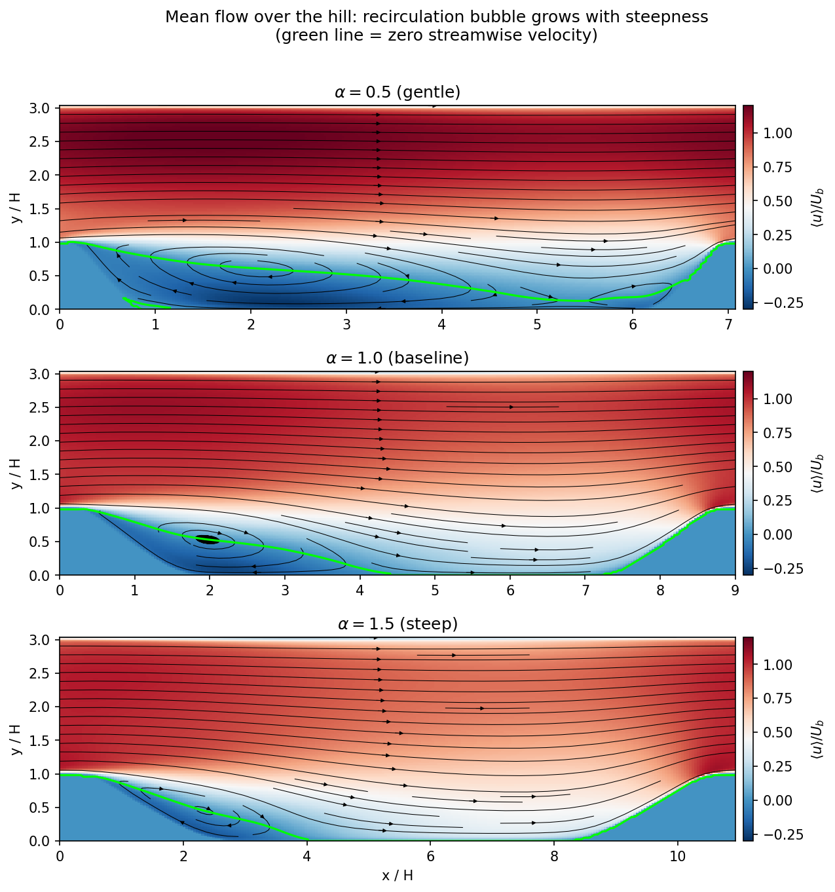
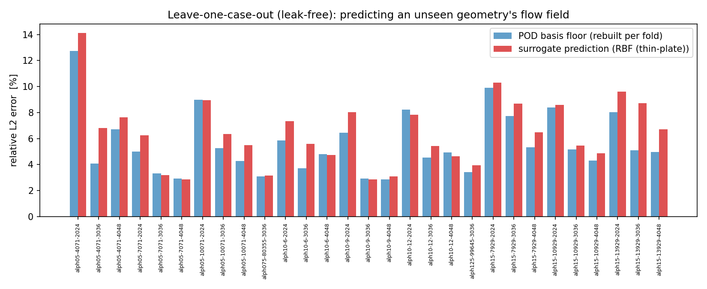
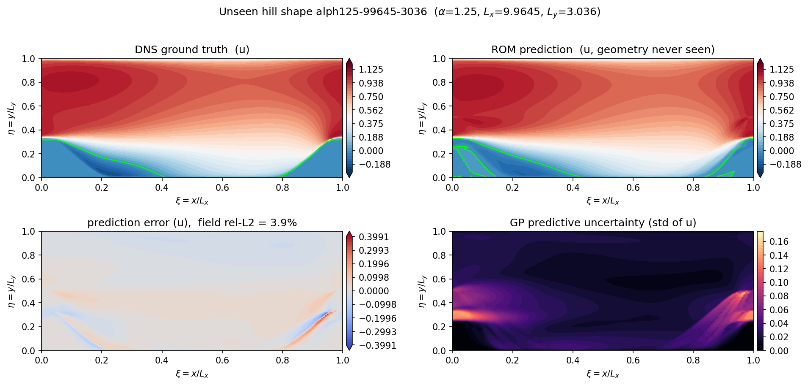
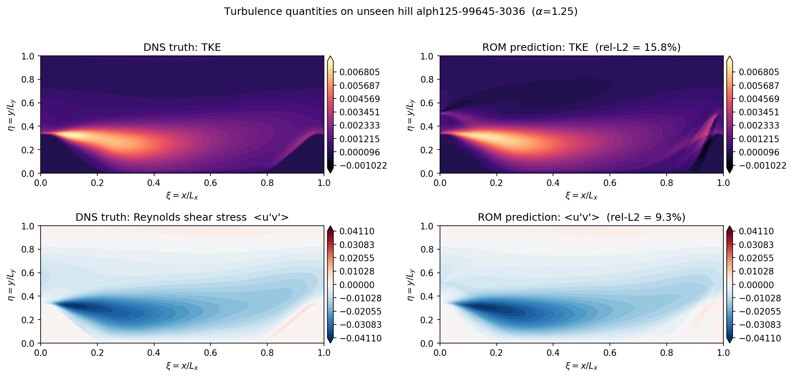

# Parametric POD-ROM for turbulent flow over periodic hills (Re = 5600)

A reduced-order model that predicts the 2D flow field over a hill geometry it
has not seen, trained on 29 DNS cases. It is built from Proper Orthogonal
Decomposition (POD) plus a regression from hill geometry to POD coefficients,
and it is validated with a leave-one-case-out test in which the basis itself is
rebuilt without the held-out case.



## Idea

The database (Xiao et al. 2020, Laizet 2021) varies the hill through three
parameters: steepness `alpha` (0.5 to 1.5), streamwise length `Lx` and domain
height `Ly`. Every case is on its own mesh, so each field is first interpolated
onto a common normalized grid (`xi = x/Lx`, `eta = y/Ly`).

1. Stack `[u, v]` of all cases into a snapshot matrix (25,600 values per case,
   each field scaled to unit std).
2. POD via SVD. Ten modes capture 95.4% of the energy.
3. Regress the ten POD coefficients on `(alpha, Lx, Ly)`. Compared: thin-plate
   RBF, Gaussian process, random forest, gradient boosting, and a small MLP.
4. Reconstruct `mean + sum_k a_k(geometry) * mode_k` for a new geometry.

The same pipeline is applied to TKE and the Reynolds shear stress `<u'v'>`.
The Gaussian process also gives a predictive std per coefficient, which is
propagated through the modes to get an uncertainty map of `u`.

## Results

Leave-one-case-out, relative L2 error, 10 modes, POD basis rebuilt for every fold:

| mean flow (u, v)                         | mean error |
|------------------------------------------|-----------:|
| POD basis floor (best possible, r = 10)  | 5.6 %      |
| RBF (thin-plate)                         | **6.5 %**  |
| Gaussian process                         | 7.4 %      |
| MLP (PyTorch)                            | 7.0 %      |
| Random forest                            | 8.7 %      |
| Gradient boosting                        | 8.8 %      |



On the unseen `alpha = 1.25` hill (it is the only case with that steepness,
so it is genuinely absent from training), the error in `u` is 3.9 %. The GP
uncertainty is high around the downstream hill crest and the separated shear
layer, which is also where most of the error sits.



For the turbulence quantities the same model does worse, as expected:

| field set       | POD basis floor | RBF    | Gaussian process |
|-----------------|----------------:|-------:|-----------------:|
| TKE + `<u'v'>`  | 15.5 %          | 21.7 % | 27.1 %           |

On the unseen hill: TKE 15.8 %, `<u'v'>` 9.3 %.



All numbers are in [`results/metrics.txt`](results/metrics.txt).

### A note on leakage

My first version built the POD basis from all 29 cases and then ran the
leave-one-out loop on the coefficients. That lets the held-out case shape the
basis, and it reported 6.0 % (RBF) with a 3.2 % floor. Rebuilding mean, scaling
and basis inside each fold gives the 6.5 % and 5.6 % above.


## Limitations

- 29 snapshots in a 3D parameter space is small. Errors are highest at the
  corners of the design space (steep hills, short domains), which is
  extrapolation.
- POD is linear, so a floor of about 5 % remains for the mean flow however
  good the regression is.
- TKE and `<u'v'>` are predicted worse than the mean flow, and the TKE
  reconstruction can go slightly negative near the downstream crest.
- The uncertainty comes from independent GPs per mode. It has not been checked
  for calibration.
- The a priori test is on a single case.

## Running it

```
pip install -r requirements.txt
```

Get the data first, see [`data/README.md`](data/README.md). Then:

```
python src/data_loader.py          # check that all 29 cases are found and parsed
python src/01_explore_data.py      # geometry family, mean-flow examples, design-space map
python src/02_pod_rom.py           # POD, surrogates, leave-one-out, mode sweep, uncertainty
python src/03_nn_surrogate.py      # MLP surrogate (needs torch)
python src/04_reynolds_stress.py   # TKE and Reynolds shear stress ROM
```

Figures go to `figures/` and metrics to `results/metrics.txt`. `02` rewrites the
metrics file and `03` to `05` append to it, so run `02` first. The first run
interpolates all cases and caches the result in `results/cache/`; later runs
are much faster.

## Layout

```
src/
  data_loader.py      parse case names, read the ASCII fields, interpolate to the common grid
  rom_core.py         POD, surrogates, leave-one-out evaluation
  hill_geometry.py    hill profile (used for the geometry figure)
  01_explore_data.py
  02_pod_rom.py
  03_nn_surrogate.py
  04_reynolds_stress.py
  figures/              output figures
results/metrics.txt   output metrics
data/                 put the DNS database here
```

## References

- H. Xiao, J.-L. Wu, S. Laizet, L. Duan, *Flows over periodic hills of
  parameterized geometries: a dataset for data-driven turbulence modeling from
  direct simulations*, Computers & Fluids 200, 104431 (2020).
  https://doi.org/10.1016/j.compfluid.2020.104431
- S. Laizet, 29-case periodic-hill DNS database, Imperial College London (2021).
  Solver: Xcompact3d / Incompact3d.
